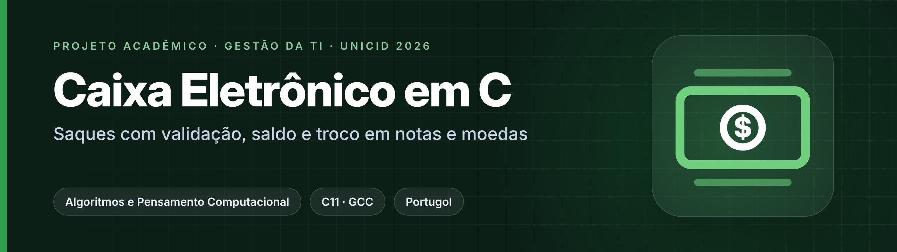
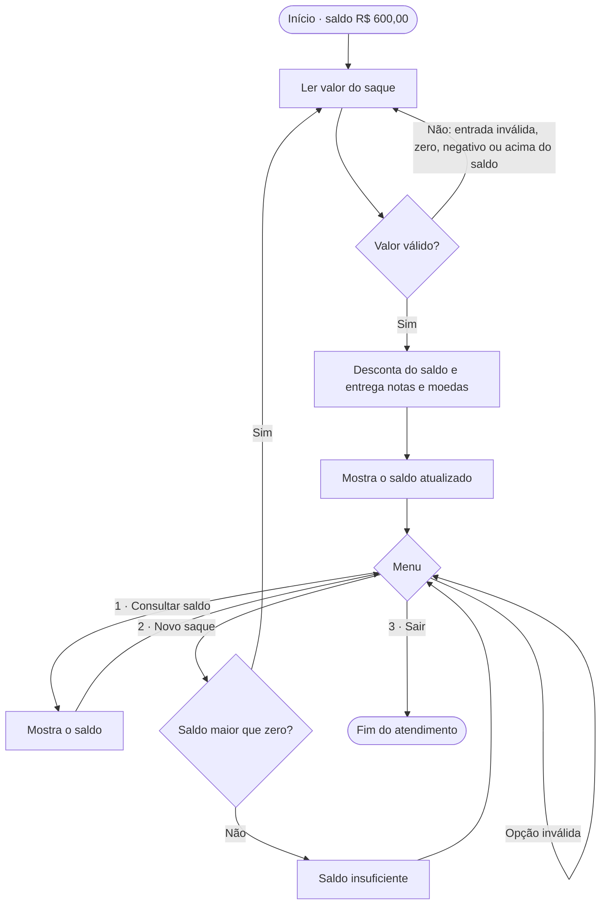

<div align="center">



# Caixa Eletrônico em C

### Saques com validação, saldo e troco em notas e moedas

**Algoritmos e Pensamento Computacional** · Atividade 2 · Projeto introdutório em C · UNICID 2026

[](caixa_eletronico.c)
[](caixa_eletronico.portugol.txt)

[](https://github.com/novaishenrique/projeto-caixa-eletronico/actions/workflows/testes.yml)


</div>

---

## Sumário

- [Sobre o projeto](#sobre-o-projeto)
- [Como funciona](#como-funciona)
- [Estrutura do repositório](#estrutura-do-repositório)
- [Como executar](#como-executar)
- [Validação e cálculo](#validação-e-cálculo)
- [Detalhes de implementação](#detalhes-de-implementação)
- [Testes](#testes)
- [Entrega](#entrega)

---

## Sobre o projeto

Projeto introdutório em C, seguindo o roteiro escolhido da atividade.

- 💰 **Saldo inicial:** R$ 600,00
- 🔁 Permite corrigir entradas inválidas, realizar vários saques e consultar o saldo durante o mesmo atendimento.
- ➖ Cada saque aprovado desconta do saldo disponível.
- 💵 O valor sacado é entregue em notas de **100, 50, 20, 10, 5 e 2** e moedas de **1**.

---

## Como funciona



Após o saque, o programa mostra o saldo atualizado e pergunta se deseja realizar uma nova transação:

| Opção | Ação |
|:---:|---|
| **1** | Consultar saldo, sem alterar o valor disponível. |
| **2** | Realizar novo saque, respeitando o saldo restante. |
| **3** | Sair e encerrar o atendimento. |

O menu reaparece após cada saque ou consulta. Quando o saldo chega a zero, uma tentativa de novo saque informa saldo insuficiente e retorna ao menu. O saldo volta a R$ 600,00 ao iniciar uma nova execução do programa.

---

## Estrutura do repositório

| Arquivo | Descrição |
|---|---|
| [`caixa_eletronico.c`](caixa_eletronico.c) | Código principal, usando apenas `stdio.h`. |
| [`caixa_eletronico.portugol.txt`](caixa_eletronico.portugol.txt) | Algoritmo para o Portugol WebStudio. |
| [`testes/executar_testes.sh`](testes/executar_testes.sh) | Compila e roda os casos de teste abaixo, conferindo a saída. |
| [`.github/workflows/testes.yml`](.github/workflows/testes.yml) | Roda os testes no GitHub a cada push (Linux, 3 rodadas, e Windows) e confere os links do README. |
| [`.github/tests/readme.test.js`](.github/tests/readme.test.js) | Teste dos links e imagens do README. |
| [`.github/capa.jpg`](.github/capa.jpg) | Capa deste README. |
| `caixa_eletronico.exe` | Gerado localmente pela compilação e ignorado pelo Git (`.gitignore`). |

---

## Como executar

> [!IMPORTANT]
> Salve os arquivos antes de compilar.

**1. Compilar** — no PowerShell, na pasta `ling_C`:

```powershell
gcc -std=c11 -Wall -Wextra caixa_eletronico.c -o caixa_eletronico.exe
```

**2. Executar** — se a compilação terminar sem erros:

```powershell
.\caixa_eletronico.exe
```

**3. Usar** — digite um número inteiro, como `123`, e pressione Enter. Se houver erro, informe outro valor quando solicitado.

> [!TIP]
> Não inclua `R$` nem centavos: digite só o número inteiro.

---

## Validação e cálculo

| Entrada | Resultado |
|---|---|
| Letras, decimais ou números extras | ❌ Mensagem de entrada inválida |
| Zero ou valor negativo | ❌ Mensagem de valor inválido |
| Valor acima do saldo atual | ❌ Saldo insuficiente |
| Valor positivo até o saldo atual | ✅ Desconta do saldo e distribui as notas e moedas |
| Opção de menu inválida | 🔁 Solicita novamente, sem alterar o saldo |

- Nos casos de erro, a leitura se repete sem realizar o saque.
- Somente quantidades positivas aparecem nas notas e moedas entregues.

---

## Detalhes de implementação

### C

- Usa `while` para repetir a leitura e `getchar` para limpar e verificar o restante da linha.
- A leitura com `%9d` limita o número a nove caracteres para evitar estouro de inteiro.
- Permite espaços antes e depois do número.
- No uso interativo, a opção `3` encerra o atendimento. Se a entrada padrão for fechada externamente, o programa também encerra, evitando repetições sem possibilidade de receber novos dados.

### Portugol

- Lê uma cadeia e utiliza as bibliotecas **Tipos** e **Texto** para validar o formato e limitar a nove caracteres antes de converter para inteiro.
- Digite somente o número, sem espaços.

A distribuição de notas e as regras de saque são iguais nos dois algoritmos.

> [!NOTE]
> O algoritmo em Portugol ainda precisa ser executado no WebStudio para validação nesse ambiente.

---

## Testes

| Entrada | Resultado |
|---|---|
| `95`, `3` | Entrega R$ 95,00, mostra saldo de R$ 505,00 e encerra. |
| `123`, `1`, `2`, `100`, `1`, `3` | Saques de R$ 123,00 e R$ 100,00; as consultas mostram R$ 477,00 e R$ 377,00. |
| `500`, `2`, `101`, `100`, `1`, `3` | Recusa R$ 101,00 com saldo de R$ 100,00; aceita R$ 100,00 e a consulta mostra saldo zero. |
| `600`, `2`, `1`, `3` | Saca todo o saldo; o novo saque é recusado; permite consultar e sair. |
| `50`, `abc`, `4`, `1`, `3` | As opções inválidas repetem o menu; a consulta continua mostrando R$ 550,00. |

Casos extras do script de testes:

| Entrada | Resultado |
|---|---|
| `abc`, `12.5`, `-5`, `0`, `700`, `1234567890`, `12 3`, `  20  `, `3` | Recusa letras, decimal, negativo, zero, valor acima do saldo, número longo e números extras; aceita `20` com espaços e mostra R$ 580,00. |
| `188`, `3` | Usa uma nota de cada valor e uma moeda. |
| `50` e a entrada fecha | Encerra o atendimento sem repetir o menu. |
| `95`, `1`, `3` com fim de linha do Windows | Funciona igual ao Linux. |

**Rodar os testes** (Linux, macOS ou Git Bash no Windows):

```bash
bash testes/executar_testes.sh
```

O script compila com `-Wall -Wextra -Werror -pedantic` e mostra `OK` ou `FALHOU` para cada caso. Os 9 casos passaram nas 3 rodadas, e o GitHub Actions repete as 3 rodadas a cada push, além de compilar e executar no Windows com o mesmo comando do PowerShell.

---

## Entrega

O roteiro exige código C, arquivo Portugol e relatório PDF com evidências:

| Item | Nome do arquivo |
|---|---|
| Código C | `GRUPO_NN_codigo.c` |
| Algoritmo Portugol | `GRUPO_NN_portugol.por` |
| Relatório de testes (PDF) | `GRUPO_NN_testes.pdf` |

---

<div align="center">

<sub>Caixa Eletrônico em C · Algoritmos e Pensamento Computacional · Gestão da Tecnologia da Informação · UNICID 2026</sub>

</div>
